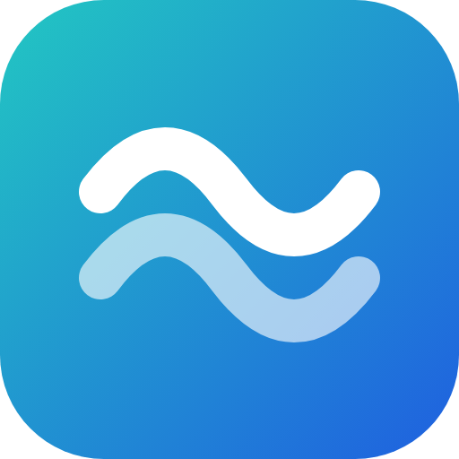

# Language Surface

Try it live: <https://fernsugi.github.io/language-surface>

**Language Surface** is a local-first translation manager for developers.
It runs entirely in your browser — no account, no server, no tracking — and is
built with plain HTML, CSS and JavaScript, so it can be hosted on GitHub Pages
or any static file host, or opened straight from disk.



---

## What it does

### Edit every language side by side
- A fast, spreadsheet-style grid: keys in rows, languages in columns
- Click a cell to edit in place; `Enter` saves and moves to the next row, `Tab` to the next cell
- A details panel shows every language of a key with room to write
- Everything is saved automatically, and every change can be undone (`Ctrl/⌘ Z`)
- Handles tens of thousands of keys (rows are virtualized)

### Find your way around
- Filter by key or text, with matches highlighted
- One-click views for **Missing** translations, **Issues** and **Pinned** keys
- Namespace tree built from your dot-notation keys (`auth.login.title`)
- Sort by key or by any language, resize and hide columns, three row heights
- Command palette (`Ctrl/⌘ K`) to jump to any key or action

### Catch mistakes
- Warns when a translation drops or adds a placeholder (`{name}`, `%s`, `{{var}}`, `${var}`, `<b>…</b>`)
- Flags stray leading or trailing spaces
- Shows line breaks and tabs inside cells

### Projects and languages
- Any number of projects; create, rename, duplicate, delete (with undo)
- Any number of languages per project, including custom codes such as `zhs`
- Add, rename, reorder and remove languages; choose the source language
- Completion percentage for every language

### Import
Drop files anywhere on the window, or use **Import**. The format is detected for you:

- **CSV** — `key,en,ja` (comma, semicolon or tab separated; Excel exports work)
- **JSON, one file per language** — `en.json`, `ja.json`, `messages_pt_BR.json`, …
- **JSON, all languages in one file** — keys first or languages first
- **TXT** — one string per line

Import into the current project (as a single undoable step) or as a new one.
Empty cells in a file never erase existing translations.

### Export
- **JSON per language**, bundled as a `.zip` (nested or flat keys)
- **Single JSON** with every language
- **CSV**

A live preview shows exactly what you will get. Arrays in imported JSON are
rebuilt on export, so files round-trip.

### AI translation (optional)
- Bring your own key: **OpenAI**, **Anthropic (Claude)**, **Z.ai (GLM)**, or any
  **OpenAI-compatible endpoint** (including local models such as Ollama or LM Studio)
- Translate one cell, one key, a selection, the current view or the whole project
- Fills only empty cells unless you ask to retranslate
- Runs several requests in parallel, backs off on rate limits, can be stopped at any time
- A whole run is one undo step
- **Glossary**: fixed term translations per language pair (`*` matches one character)
- **Instructions**: describe your product and tone once per project
- Optional maximum length per translation; placeholders are preserved

With Anthropic, requests use low effort (interface strings are short, simple
work) and opt in to the API's server-side fallback, so a string that a safety
classifier declines is retried on the fallback model Anthropic recommends
instead of failing. Models that do not accept either option are detected and
called without it.

---

## Local-first

> **Everything is stored in your browser** (IndexedDB, with a localStorage fallback).

- No servers, no database, no analytics, no accounts
- No third-party requests: fonts and icons are bundled
- Download a full backup from **Settings → Your data**, and restore it anywhere

If you used the original version of Language Surface, your projects and
settings are picked up automatically the first time you open this one.

## A note on API keys

To use AI translation you store an API key in your browser.

- The key is saved **only** in this browser and is never part of a backup
- It is sent **only** to the provider you selected, directly from the page
- There is no backend in between

Use at your own risk: prefer a restricted key with a spending limit, or fork
the project and add your own proxy.

---

## File formats

### CSV
```csv
key,en,ja
lp.hello,Hello,こんにちは
lp.bye,Good Bye,さようなら
```

### JSON, one file per language
```json
// en.json
{
  "lp": {
    "hello": "Hello",
    "bye": "Good Bye"
  }
}
```

### JSON, all languages
```json
{
  "lp": {
    "hello": { "en": "Hello", "ja": "こんにちは" },
    "bye":   { "en": "Good Bye", "ja": "さようなら" }
  }
}
```

### Text
One word or sentence per line. Each line becomes a key named after its line number
(`prefix_1`, `prefix_2`, …), so the same line in another language's file lands on the same key.
Blank lines are skipped.

---

## Getting started

1. Clone or fork the repository
2. Open `index.html`, or serve the folder with any static server
3. Or deploy to GitHub Pages

There is no build step and there are no dependencies.

### Keyboard shortcuts

| Shortcut | Action |
| --- | --- |
| `Ctrl/⌘ K` | Search keys and commands |
| `/` | Filter the grid |
| `N` | Add a key |
| `Enter` | Edit the selected cell |
| `Ctrl/⌘ Enter` | Translate the selected cell with AI |
| `Ctrl/⌘ Z`, `Shift Ctrl/⌘ Z` | Undo, redo |
| `Ctrl/⌘ I` | Show or hide the details panel |
| `?` | All shortcuts |

## Development

```
index.html          entry point
css/                design tokens, base styles, components, layout
js/core/            parsing, import/export, language data, AI clients (no DOM)
js/store/           project model, undo/redo, persistence, migration
js/ui/              DOM helpers, icons, menus, dialogs, toasts
js/views/           screens and dialogs
tests/              unit tests
```

Run the tests with Node 20 or newer (no install needed):

```bash
node --test
```

## Tech stack

- HTML, CSS and vanilla JavaScript — no framework, no bundler
- IndexedDB for storage
- [Geist](https://vercel.com/font) typeface and [Lucide](https://lucide.dev) icons, bundled locally
- OpenAI Responses API, Anthropic Messages API and OpenAI-compatible chat completions (optional)

## License

MIT — free to use, modify and distribute. Third-party assets are listed in
[THIRD_PARTY_NOTICES.md](./THIRD_PARTY_NOTICES.md).

## Who it is for

- Indie developers
- Game localization
- App and website UI translation
- Anyone tired of bloated translation tools

Contributions and ideas are welcome.
